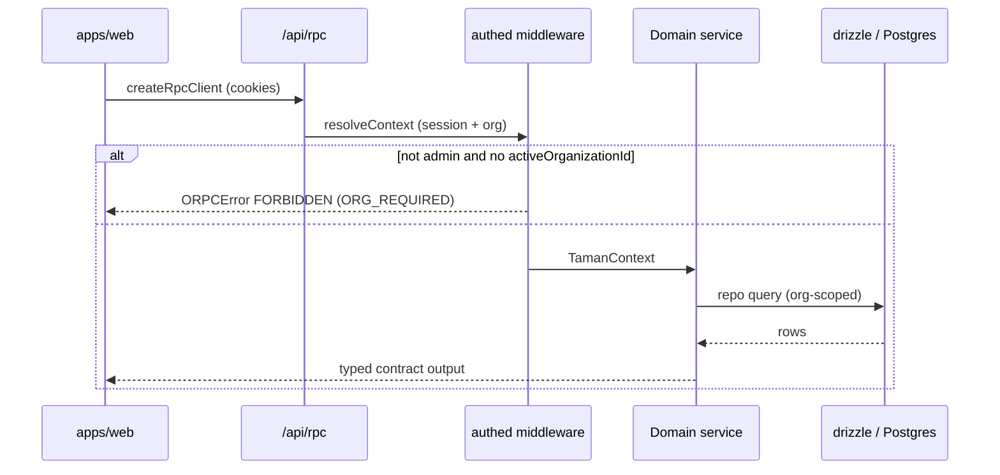

## Request path



1. The Vue app calls `client.todo.list(...)` from `apps/web/src/api/orpc.ts`. The client is `createRpcClient` with `credentials: 'include'` and URL `${VITE_API_URL}/api/rpc`.
2. Nitro serves `apps/api/server/routes/api/rpc/[...path].ts`. The oRPC `RPCHandler` matches a procedure on `router` (`menu` + `todo`).
3. Procedures use `os` (unhandled-error mapping) and `authed` (`apps/api/server/rpc/base.ts`). `authed` runs `resolveContext`: better-auth session, drizzle, membership. Non-admins **must** have `session.activeOrganizationId` or the call fails with `FORBIDDEN` and `data.code = ORG_REQUIRED`.
4. The procedure constructs a domain **service** (`TodoService`) which talks to a **repo** (`TodoRepo`) via drizzle.
5. CORS is re-applied on the raw `Response` (`applyCorsToResponse`) because oRPC and better-auth bypass Nitro's event headers on non-2xx.

REST auth lives at `/api/auth/[...all]` (better-auth). Health: `GET /healthz` (liveness), `GET /readyz` (database).

## Layers

```text
apps/web  ──oRPC──►  apps/api
                         │
packages/shared/api-contract   (shared types + oc.input/output)
packages/shared/rbac           (admin + org access control)
                         │
              server/domains/<feature>
                 service  →  repo  →  @taman/db-pg schemas
```

Copy that split when adding a feature. The procedure owns HTTP/RPC errors (`NOT_FOUND`); the service returns `null` for a missing row.

## Realtime

Todo `live` is an oRPC event iterator.

```text
TodoService.subscribe
        │
        ▼
getTodoPublisher(cloudflareEnv(event))
        │
        ├─ Worker + TODO_PUBLISHER binding → DurablePublisher
        │     class TodoPublisherObject (exports.cloudflare.ts)
        │     resume retention 300s
        └─ nitro dev / Node → MemoryPublisher (in-process only)
```

Channels are `todo:${organizationId}`. A subscriber only sees its org. The Durable Object is bound as `TODO_PUBLISHER` / class `TodoPublisherObject` in `nitro.config.ts` (SQLite migration tag `v1`).

The client reconnects with `context: LIVE_RETRY` (`@vinicunca/request/orpc`): infinite retries on network and 5xx; a 4xx such as `UNAUTHORIZED` stops the stream. Resume uses `Last-Event-ID` (allowed in CORS `allowHeaders`).

## Email

```text
better-auth callback
    → useEmail().dispatcher.dispatch(job)
         │
         ├─ EMAIL_QUEUE binding → QueueEmailDispatcher (Cloudflare Queue)
         │     consumer: cloudflare:queue plugin
         │     queue taman-email, max_retries 5, DLQ taman-email-dlq
         └─ no queue → InlineEmailDispatcher (deliver immediately)
                │
                ├─ EMAIL binding → Cloudflare Email Routing
                └─ no binding → console sender (dev)
```

Jobs are rendered by `@taman/emails` (Maizzle): invitation, reset-password, verify-email. From address comes from `NITRO_EMAIL_FROM` / `NITRO_EMAIL_FROM_NAME`.

## Auth cookies

better-auth cookie prefix is `taman` (`advanced.cookiePrefix`). The web client talks to `VITE_API_URL` with credentials, so `NITRO_TRUSTED_ORIGINS` must include the web origin.

## Access modes

`preferences.app.accessMode` (`frontend` | `backend` | `mixed`) controls how `generateAccessible` builds menus and routes:

- **frontend** — filter static `accessRoutes` by `meta.authority` vs session roles
- **backend** — `fetchMenuListAsync` (the web app still has a TODO here)
- **mixed** — merge both by route name

Default in taman-core is `frontend`. See [Permissions](/taman/guides/permissions).
